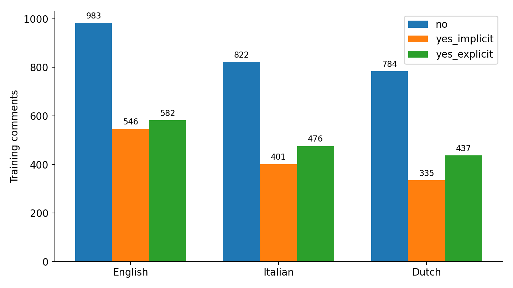
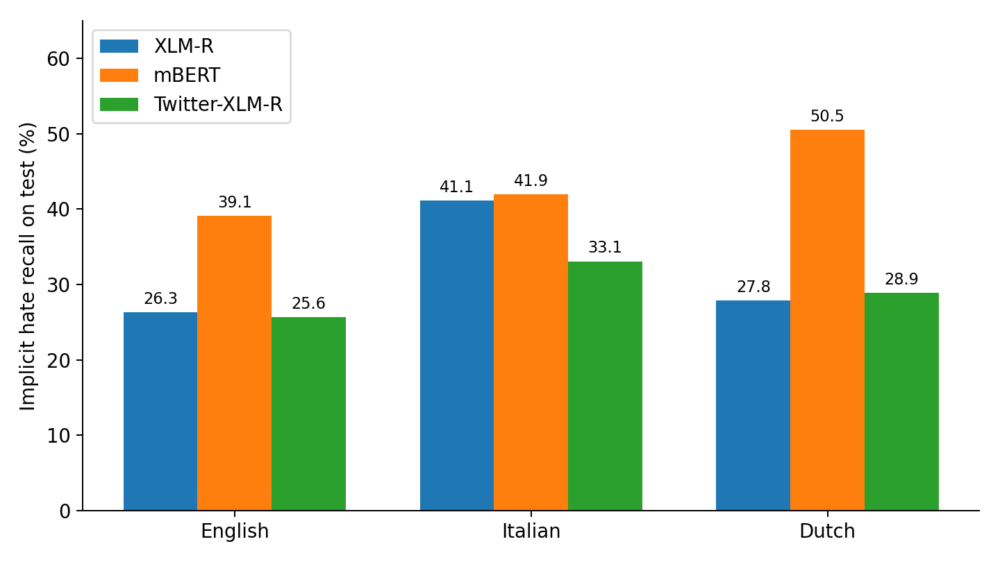
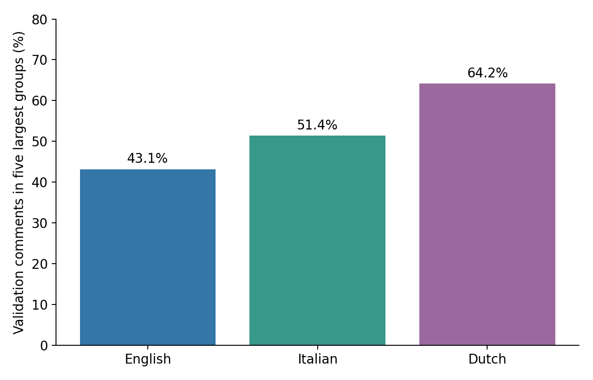

# Investigasi penyebab hasil klasifikasi StereoQueerEval

Tanggal pemeriksaan: 22 Oktober 2026. Analisis memakai sembilan run model per bahasa tanggal 20 Oktober dan output ablation Inggris yang tersimpan di notebook arsip. Tidak ada training baru, perubahan data sumber, atau pemilihan konfigurasi menggunakan skor test. Pemeriksaan test di sini bersifat diagnosis setelah evaluasi.

## Kesimpulan

Penyebab yang paling didukung adalah kesulitan kelas implisit, variasi konteks antar-kelompok, validation yang hanya mencakup sedikit kelompok, preprocessing yang menghapus petunjuk, dan overfitting/overconfidence. Belum ada bukti bahwa korpus atau anotasi secara umum rusak.

## Ukuran dan komposisi data

| Bahasa | Train | Validation | Test | No pada train | Implicit pada train | Explicit pada train | Kelompok validation | Proporsi lima kelompok terbesar di validation |
|---|---:|---:|---:|---:|---:|---:|---:|---:|
| EN | 2111 | 292 | 586 | 983 | 546 | 582 | 23 | 43.15% |
| IT | 1699 | 220 | 481 | 822 | 401 | 476 | 17 | 51.36% |
| NL | 1556 | 226 | 456 | 784 | 335 | 437 | 13 | 64.16% |

Total 7.627 baris, tanpa komentar kosong atau ID lintas subset. Seluruh baris/kolom split sesuai CSV original. Ketidakseimbangan kelas bersifat moderat: no sekitar 48,43%, implicit 24,13%, explicit 27,44%. Tidak ada konflik label pada komentar identik menurut normalisasi NFKC + casefold + whitespace yang diperiksa. Ini tidak mengukur inter-annotator agreement dan tidak membuktikan seluruh label benar.

## Kelas implisit dan ketergantungan konteks

Ketiga model sekaligus salah pada 74 dari 156 contoh implicit test EN (47,44%), 48 dari 124 IT (38,71%), dan 38 dari 97 NL (39,18%). Ini adalah sinyal masalah bersama lintas arsitektur, bukan bukti bahwa labelnya salah.

Contoh EN `training_EN_0191`: "Too bad...I liked that show" berlabel implicit dalam konteks berita pemeran transgender di Modern Family. Ketiga model komentar-saja memprediksi no. Contoh `training_EN_0226`: "Freedom and justice" ditambah bendera pelangi berlabel no, tetapi ketiga model memprediksi implicit. Contoh pertama memperlihatkan kebutuhan konteks; contoh kedua konsisten dengan kegagalan memahami dukungan, dan kehilangan jenis emoji mungkin berkontribusi. Itu masih hipotesis per contoh.

Penyelenggara meminta klasifikasi komentar memakai judul dan deskripsi sebagai konteks: https://stereoqueereval.github.io/stereoqueereval/. Target dan stereotype adalah label diagnostik, tidak boleh dijadikan fitur gold untuk klasifikasi hate speech.

## Generalisasi kelompok dan representativitas validation

Video/context group dipisahkan antar-subset, sehingga model diuji pada kelompok yang belum dilihat. Jangan mengacak ulang komentar agar topik video masuk ke train dan test hanya untuk meningkatkan skor. Bahasa EN memiliki 173 kelompok train, IT 136, NL 84. Jumlah baris tidak sama dengan jumlah konteks independen.

Komposisi identitas target juga berbeda walaupun proporsi hate_speech cukup serupa. EN group_t adalah 8,56% validation dan 20,14% test. IT individual_t adalah 0,45% validation dan 8,11% test. Target digunakan untuk memahami perbedaan komposisi, bukan untuk mengoptimalkan test atau sebagai fitur input.

Bootstrap eksploratif sebanyak 2.000 resampling kelompok pada prediksi Twitter-XLM-R yang sudah tetap memberi rentang macro-F1 validation EN 0,523-0,628; IT 0,475-0,603; NL 0,452-0,598. Ini mengukur variasi sampel kelompok pada checkpoint tetap, bukan variasi seed atau interval yang mengoreksi pemilihan checkpoint. Selisih kecil belum cukup untuk mengklaim kemenangan stabil.

## Preprocessing dan tokenisasi

Emoji muncul pada train EN 11,89%, IT 18,78%, NL 17,22%. Casefold mengubah sekitar 91-95% komentar. Tidak semua perubahan huruf memengaruhi makna, tetapi seluruh jenis emoji menjadi placeholder yang sama.

Output ablation Inggris: E0 0,5776; E1 0,6060; E2 0,6161; E3 0,5793; E4 0,5702; E5 0,5043; E6 0,6256 pada macro-F1 validation. E1-E0 dan E2-E1 mendukung mempertahankan emoji dan kapitalisasi pada run ini. E3 menunjukkan menghapus class weights justru menurunkan skor. E4/E5 menunjukkan konteks tambahan secara naif tidak otomatis membantu. E6 mengubah judul, learning rate/warmup relatif ke baseline; efek tidak dapat diatribusikan ke satu faktor.

| Tokenizer | EN >384 | IT >384 | NL >384 |
|---|---:|---:|---:|
| FacebookAI/xlm-roberta-base | 8 (0.27%) | 6 (0.25%) | 3 (0.13%) |
| google-bert/bert-base-multilingual-uncased | 7 (0.23%) | 7 (0.29%) | 6 (0.27%) |
| cardiffnlp/twitter-xlm-roberta-base | 8 (0.27%) | 6 (0.25%) | 3 (0.13%) |

Panjang dihitung pada komentar dengan preprocessing baseline, termasuk special tokens. Hanya 0,13-0,29% yang melebihi 384 token. Pada test, XLM-R memotong 2 komentar EN dan 0 IT/NL; mBERT memotong 1 EN, 0 IT, 1 NL. Pemotongan tidak menjelaskan ratusan kesalahan. Angka ini tidak berlaku untuk input komentar+judul/deskripsi.

mBERT memiliki setidaknya satu UNK pada 11,91% komentar EN, 3,54% IT, dan 3,71% NL, tetapi hanya 0,64%, 0,17%, dan 0,21% seluruh token. Karakter yang paling sering tidak dikenal adalah apostrof tipografis dan tanda kutip. Ini faktor tambahan khusus mBERT, bukan penjelasan utama bagi kedua model XLM-R yang hampir tidak memiliki UNK.

Satu pasangan NL menjadi identik setelah preprocessing baseline, melintasi train/test: training_NL_2127 dan training_NL_0751, keduanya no. Teks berbeda hanya dalam kapitalisasi, whitespace, dan jenis emoji. Ini potensi kebocoran akibat transformasi input, berskala satu pasangan, dan tidak menjelaskan skor rendah. Jangan mengubah test sekarang; pertahankan sebagai temuan audit atau gunakan varian raw pada protokol berikutnya.

## Overfitting dan confidence

Pada Twitter-XLM-R IT, logged train loss turun 1,1067 ke 0,2917, sementara validation loss minimum 0,9879 naik ke 1,4861. Di checkpoint macro-F1 terbaik epoch 9, validation loss 1,4475. Pada test, 43,78% prediksi yang salah memiliki confidence >=90%, dengan rata-rata confidence salah 81,09%. Confidence adalah probabilitas softmax model, bukan probabilitas yang terkalibrasi.

Cross-entropy sangat menghukum salah yang yakin. Sebaliknya F1 memakai label argmax sehingga macro-F1 dapat naik ketika loss naik. Loss menggunakan class weights train; skala antarrun dengan bobot berbeda atau smoothing berbeda tidak langsung sebanding.

## Tindakan yang didukung temuan

1. Jadikan preprocessing raw (emoji dan case dipertahankan) sebagai kandidat untuk uji validation berikutnya; jangan anggap efek Inggris berlaku otomatis di IT/NL.
2. Tetap pisahkan kelompok; uji konfigurasi menggunakan group-aware cross-validation pada development data, dengan test dibekukan. Evaluasi variasi beberapa seed, bukan memilih split yang skornya tertinggi.
3. Gunakan training multilingual gabungan pada split baru yang sama untuk menguji manfaat transfer lintas bahasa. Belum bisa menyalahkan pemodelan per bahasa berdasarkan perbandingan dengan split lama.
4. Gunakan audit manual terarah pada contoh implicit dan false positive dukungan dari validation; pastikan mengikuti panduan anotasi. Jangan otomatis mengganti label berdasarkan suara model.
5. Uji label smoothing/dropout sebagai eksperimen terpisah untuk overconfidence; ukur F1, loss standar, dan kalibrasi. Jangan berharap menambah epoch menyelesaikan kekurangan konteks.
6. Untuk mBERT, pertimbangkan ablation normalisasi apostrof/tanda kutip. Untuk konteks, pertahankan budget komentar dan uji judul selektif sebelum menambahkan deskripsi.

## Berkas dan metode

- Data: `../data/{en,it,nl}-splitting/*-{train,val,test}.csv`, `split_manifest.csv`, dan `../data/original/*.csv`.
- Prediksi: `../results/<model>/<run>/<bahasa>/{validation,test}_predictions.csv`. Sembilan run tanggal 20 Oktober 2026.
- Output Inggris E0-E6: `../archive/SemEval2027_Semua_Eksperimen_E0_E6.ipynb`.
- Nilai rinci: `investigasi_data.json`, `investigasi_tokenisasi.json`, `investigasi_lanjutan.json`, `integritas_data.json`, `dinamika_training.json`.
- Tokenizer dari cache lokal; tidak ada pengunduhan bobot/training baru. Analisis tidak menghitung agreement annotator karena tidak tersedia label per annotator.
